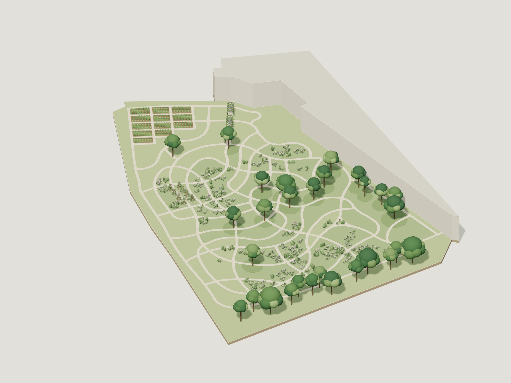

# 智品网络科技花园 · 三维模型

[打开在线模型](https://caiseyingzi.github.io/zhipin-garden-3d/)

根据用户提供的单页总平面 PDF，提取矢量园路、种植岛、现状乔木及花架符号，建立可交互的花园空间模型。

## 查看和下载

- 拖动旋转、滚轮缩放、右键平移；按 R 复位，按 1 / 2 / 3 切换视角。
- 可单独开关草坪、园路、花境、菜园、乔木、花架及办公楼局部。
- 正俯视下可叠加提取线稿，检查园路与分区对应。
- 可调整假定建筑高度、乔木透明度，导出当前图层及高度的 GLB。
- [标准 GLB 模型](模型/园林模型.glb)
- [OBJ + MTL 压缩包](模型/园林OBJ模型.zip)
- [重建平面 SVG](参考/重建平面.svg)

## 重建内容

| 内容 | 重建依据 |
| --- | --- |
| 园路与 84 个闭合分区 | 原 PDF 黑色矢量曲线，闭合、裁切并三角化 |
| 12 块已种植菜畦 | 原图菜畦轮廓；行列方向取原始长边 |
| 29 株现状乔木 | 独立冠幅轮廓的中心和直径 |
| 15 道拱廊肋架 | 入口处重复构架平面符号 |
| 8 座塔形花架 | 西侧 8 个平面基座符号 |
| 低矮种植 | 绿色线条的连通组团，不作为单株数量或品种确认 |
| 办公楼局部 | 图幅内可见轮廓，东侧按图幅截断 |

花园建模范围约 6,617 m²。图示 10 米比例尺对应 86.46 个 PDF 点，模型统一使用米制坐标。

## 建模假定

- 尺度由图上 0-10 米比例尺反算，不能替代测绘或施工放样尺寸。
- 场地采用平整基面；办公楼局部体量暂取 9 米，拱廊 2.8 米、塔形花架 2.7 米。
- 29 株现状乔木的中心和冠幅来自图示轮廓；株高、树形、花色与材质为示意。
- 低矮种植按绿色符号连通组团定位，株数和品种不作为种植清单。
- 花境、树下地被密度和菜畦竖向构造为表现假定；路网和 12 块菜地保留图示平面轮廓。
- 建模范围沿可见花园边界裁定，办公楼仅重建图幅可见局部，不推断其完整外轮廓。

## 文件与验证

GLB 为自包含文件，可用支持 glTF 2.0 的建模或查看软件打开。OBJ 压缩包包含几何与 MTL 材质文件。

已使用 Three.js GLTFLoader 回读 GLB，模型包围盒往返误差为 0 米；已检查所有顶点有限值、OBJ 面索引与园路三角化面积。此类数值检查验证转换过程，不能作为测绘精度声明。

原始 PDF、原图截图、完整矢量提取数据与本地路径均未加入公开发布目录。在线对照图为提取几何生成的重建线稿。

页面使用 Three.js 0.180.0，MIT 许可见 [第三方声明](THIRD_PARTY_NOTICES.md)。

## 发布方式

本目录为预构建静态页面，GitHub Pages 从 main 分支根目录发布，使用 .nojekyll。
