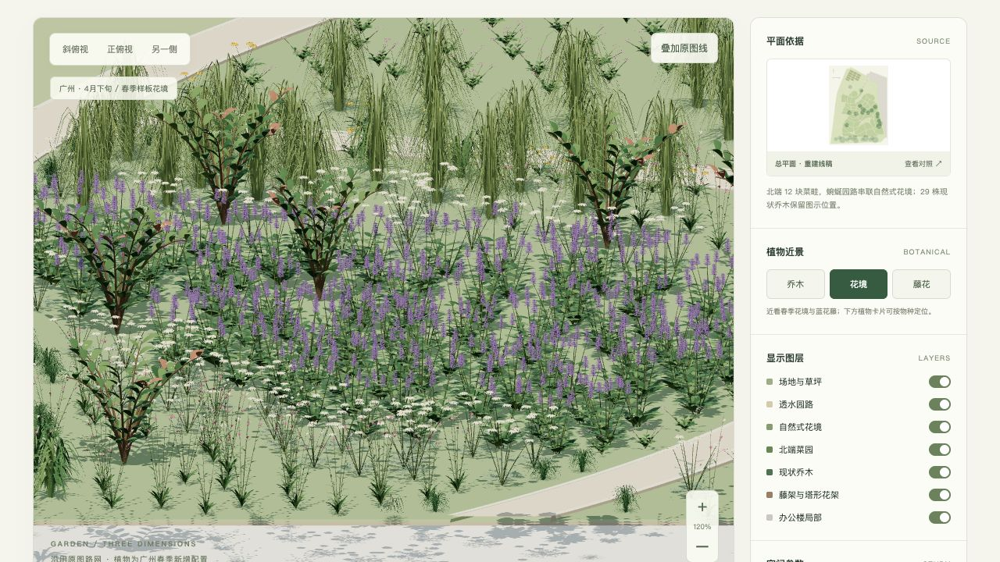

# 智品科技花园 · 广州·4月下旬 春季试验版

[打开在线三维花园](https://caiseyingzi.github.io/zhipin-garden-3d/?edition=guangzhou-spring-20261021) · [植物清单](植物清单.html)

本版沿用总平面提取的园路、种植岛、菜园、现状乔木和花架位置，新增广州春季配植提案。
2026-11-03 经用户明确要求公开本版。原 PDF、原图截图、原始提取资料、历史归档及四季视频不在本次公开范围。

## 查看和下载

- [SketchUp 原生模型 · 2018 格式](模型/智品科技花园-广州春季.skp)
- [自包含 GLB](模型/园林模型.glb)
- [植物清单 CSV](植物清单.csv) · [Markdown 清单](植物清单.md)
- [植物配置平面 SVG](配置/广州春季配置.svg) · [种植记录 JSON](配置/广州春季布置.json)
- [依据提取几何重建的平面 SVG](参考/重建平面.svg)

拖动旋转、滚轮缩放、右键平移；按 R 复位，1 / 2 / 3 切换视角。
可开关分类图层、查看花境与蓝花藤近景、在植物卡片中按物种定位，或导出当前状态的 GLB。
此前版本保存在本地及 Git 历史中。本次网页不链接本地归档；大体积 OBJ 完整包继续留在本地。

## 植物与数量

粉萼鼠尾草、木茼蒿、美女樱、山桃草、勋章菊、山菅兰、麦冬、芒、石斑木、蓝花藤、黄木香，共11项。
地栽4614丛模型单元，保留519组原图符号的位置并新增4095丛填充；蓝花藤8株根基、黄木香8株根基。
现状乔木29株的物种仍待鉴定，北端12畦菜园仅作叶丛示意。

本清单是新增配植提案，不是原设计苗木表、现场植物鉴定或采购清单。
科、属、种/杂交类群、拟选花色、模型表现尺寸、数量与来源见完整植物清单。
分类与物候资料核对日期仍为2026-10-21；公开发布不表示重新完成了植物学或现场调查。

## 尺度与季节假定

花园建模范围约6617平方米，使用原图0–10米图示比例尺换算为米制坐标。
保留29株现状乔木、12块菜畦、15道拱廊肋架和8座塔形花架。
办公楼局部暂取9米，拱廊2.8米，塔形花架2.7米，植物高度、冠幅及间距也含方案假定。
木茼蒿、美女樱和勋章菊作为春季草花配置；芒与麦冬仅表现春季绿叶。
花量是方案表现，不保证同一天全园盛花。施工前仍需核实日照、排水、苗源及实际尺寸。

## 文件与检查

- [模型验证](验证/模型验证.json)：锚点、布置边界、有限顶点、园路面积、OBJ索引和GLB回读。
- [SKP原生回读](验证/SKP验证.json)：441个组件定义、36874个组件实例、39种颜色材质；整体尺寸回读误差0米。
- SKP已用SketchUp C API写入并回读，未进行SketchUp桌面版打开实测；保留网格及命名组件，网页控制器不属于SKP内容。

页面与模型由提取几何重建，不包含原始PDF、原图截图、微信路径或外部植物资产。
Three.js 0.180.0 的MIT声明见[第三方声明](THIRD_PARTY_NOTICES.md)。
发布范围见[公开设置](隐私设置.json)。本目录为预构建静态文件，Pages从main分支根目录发布。
