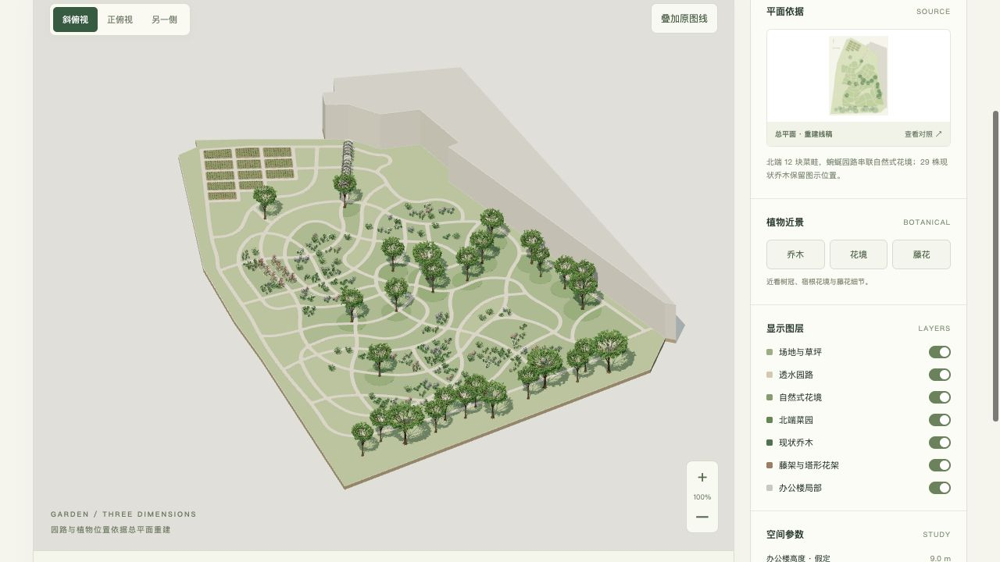

# 智品网络科技花园 · 三维模型

> 私有项目，禁止公开部署。GitHub 仓库已设为私有，旧 GitHub Pages 页面已关闭。网页和模型文件仅允许通过身份验证向指定收件人分享；原始 PDF 继续仅保存在本地。当前规则见 [隐私设置](隐私设置.json)，处理记录见 [隐私验证](验证/隐私处理.json)。

根据用户提供的单页总平面 PDF，提取矢量园路、种植岛、现状乔木及花架符号，建立可交互的花园空间模型。

## 高精细植物版 · 2026-10-20

- 29 株乔木加入根颈、三级分枝和独立曲面叶片；冠幅、定位仍按原图校核。
- 519 组种植符号细化为自然灌丛及 7 类宿根形态，包括观赏禾草、羽状蕨类、阔叶观叶、蓝紫穗状花、白色与柔粉舌状花、球形小花序。
- 菜园改为莲座状曲面叶，拱廊增加羽状复叶、花梗与下垂花穗，塔形花架增加重瓣攀援花。
- 叶片和花瓣是可导出的曲面几何，无需在线植物素材或贴片图片；SKP 保留实际几何。当前 SKP 为 68.4 MiB，GLB 为 16.3 MiB。
- 网页新增乔木、花境、藤花近景。旋转视角时复用静态阴影；图层和高度变化会重新计算阴影。
- 植物品种与季相是表现性配置，不是已确认的种植清单。此版为程序化几何植物，不宣称照片级扫描资产。

[乔木细节](预览/02-高精细乔木.png) · [花境细节](预览/03-高精细花境.png) · [藤花细节](预览/04-高精细藤花.png) · [本次验证](验证/植物升级验证.json)



## 查看和下载

- 拖动旋转、滚轮缩放、右键平移；按 R 复位，按 1 / 2 / 3 切换视角。
- 可单独开关草坪、园路、花境、菜园、乔木、花架及办公楼局部。
- 正俯视下可叠加提取线稿，检查园路与分区对应。
- 可调整假定建筑高度、乔木透明度，导出当前图层及高度的 GLB。
- [SketchUp SKP 模型 · 2018 格式](模型/智品科技花园.skp)（默认完整模型，建筑高度 9 米）
- [标准 GLB 模型](模型/园林模型.glb)
- 高精细 OBJ + MTL 体量较大，保存在本地完整交付包中。
- [重建平面 SVG](参考/重建平面.svg)

## 重建内容

| 内容 | 重建依据 |
| --- | --- |
| 园路与 84 个闭合分区 | 原 PDF 黑色矢量曲线，闭合、裁切并三角化 |
| 12 块已种植菜畦 | 原图菜畦轮廓；行列方向取原始长边 |
| 29 株现状乔木 | 独立冠幅轮廓的中心和直径 |
| 15 道拱廊肋架 | 入口处重复构架平面符号 |
| 8 座塔形花架 | 西侧 8 个平面基座符号 |
| 低矮种植 | 绿色线条的连通组团，不作为单株数量或品种确认 |
| 办公楼局部 | 图幅内可见轮廓，东侧按图幅截断 |

花园建模范围约 6,617 m²。图示 10 米比例尺对应 86.46 个 PDF 点，模型统一使用米制坐标。

## 建模假定

- 尺度由图上 0-10 米比例尺反算，不能替代测绘或施工放样尺寸。
- 场地采用平整基面；办公楼局部体量暂取 9 米，拱廊 2.8 米、塔形花架 2.7 米。
- 29 株现状乔木的中心和冠幅来自图示轮廓；株高、树形、花色与材质为示意。
- 低矮种植按绿色符号连通组团定位，株数和品种不作为种植清单。
- 花境、树下地被密度和菜畦竖向构造为表现假定；路网和 12 块菜地保留图示平面轮廓。
- 建模范围沿可见花园边界裁定，办公楼仅重建图幅可见局部，不推断其完整外轮廓。

## 文件与验证

SKP 为原生 SketchUp 2018 文件，使用米制单位。园路、花境、菜园、乔木、花架、办公楼等按 7 个分类标签组织，保留 379 个组件定义、9,028 个组件实例和 34 种颜色材质；可在 SketchUp 中继续编辑。SKP 对应默认完整模型，网页调整后的当前状态可另行导出 GLB。

SKP 已用 SketchUp C API 写入并回读，核对文件版本、单位、分类标签、组件数量、材质颜色、各组件表面积和整体尺寸；尺寸往返误差为 0 米。本机未安装 SketchUp，未进行桌面端打开实测。转换保留的是网格几何与组件，不包含网页的参数控制器。

GLB 为自包含文件，可用支持 glTF 2.0 的建模或查看软件打开。OBJ 压缩包包含几何与 MTL 材质文件。

已使用 Three.js GLTFLoader 回读 GLB，模型包围盒往返误差为 0 米；已检查所有顶点有限值、OBJ 面索引与园路三角化面积。此类数值检查验证转换过程，不能作为测绘精度声明。

原始 PDF、原图截图、完整矢量提取数据与本地路径均未加入公开发布目录。在线对照图为提取几何生成的重建线稿。

页面使用 Three.js 0.180.0，MIT 许可见 [第三方声明](THIRD_PARTY_NOTICES.md)。

## 私有访问

当前没有可用的对外分享页面。此前的公开 GitHub Pages 已停用，私有仓库仍保留模型文件。后续如需在线浏览，应先在服务端配置指定收件人身份验证，并同时保护页面、模型、预览和所有下载地址。仅隐藏链接或添加前端密码框不能替代访问控制。

## 本地复建

原始图纸保存在参考/总平面.pdf。当前目录保留 Python 提取脚本、Three.js 构件、导出与验证脚本。Python 依赖见 requirements.txt，Three.js 已随项目本地保存。

```bash
python3 src/extract-plan.py
python3 src/resolve-plan.py
node src/build.mjs
node --test src/vegetation.test.mjs
node src/validate.mjs
python3 src/build-skp.py --sdk-dir /path/to/local/sketchup-sdk-mac
python3 -m http.server 8773 --bind 127.0.0.1
```

OBJ 下载包包含 .obj 与 .mtl；完整交付 ZIP 也包含此 OBJ 压缩包，解压后可继续编辑。升级前的模型与源码保存在历史版本/植物升级前-20261020。

SKP 复建脚本需要 macOS、Xcode 命令行工具，以及本地可用的 SketchUp C API framework。脚本不自动下载、安装或再分发 SDK。运行库来源和校验值记录在验证/SKP验证.json；交付包只包含自有转换源码与输出模型。

完整原图仅在本地参考目录中。本地完整交付 ZIP 含原始图纸，不应作为对外模型下载包。GitHub发布目录是此前的静态文件副本，目前存于私有仓库；原公开发布脚本已根据隐私设置停用。
